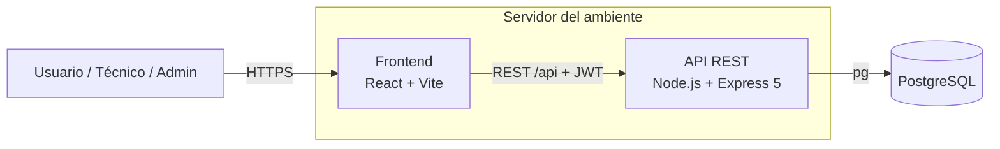
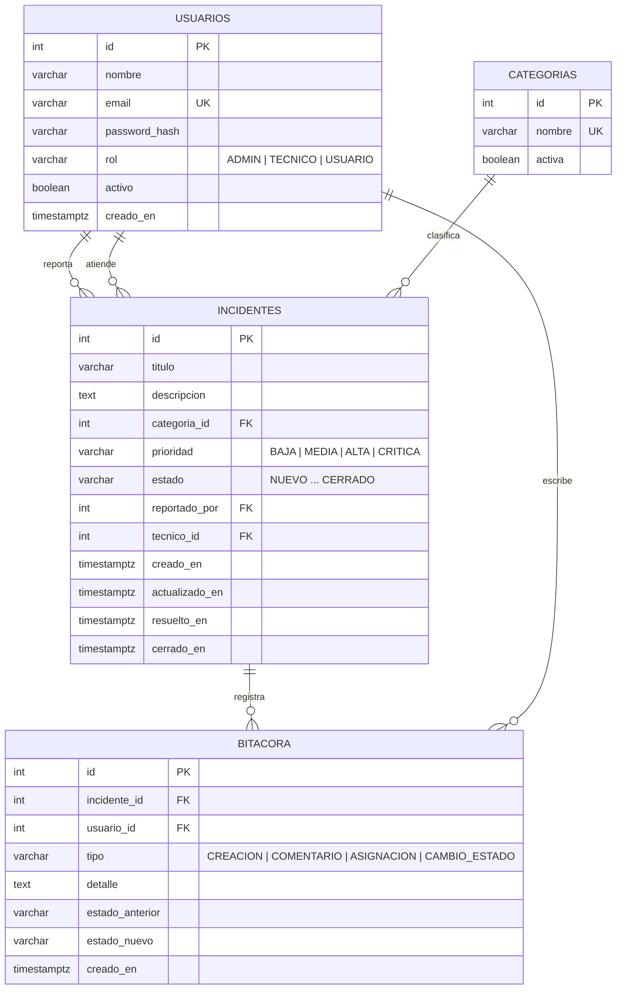
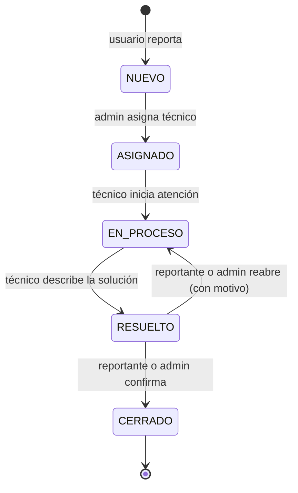

# Arquitectura

IT Incident Hub reemplaza los reportes de incidentes dispersos en llamadas, mensajería y correo por una aplicación web con trazabilidad completa: quién reportó, quién atendió, qué cambió y cuándo.

## Vista general



| Capa | Tecnología | Responsabilidad |
|---|---|---|
| Frontend | React 19, React Router 8, Vite 8 | Interfaz por rol, filtros en la URL, dashboard |
| API | Node.js 22, Express 5, JWT, bcryptjs, helmet | Reglas de negocio, autenticación, autorización, validación |
| Datos | PostgreSQL 16 | Persistencia, integridad (FK, CHECK), bitácora |
| Operación | PM2, GitLab CI/CD con runner autohospedado, GitHub Actions | Validación, empaquetado y despliegue por ambiente |

En desarrollo, Vite (puerto 5173) redirige `/api` hacia Express (puerto 4000). En staging y producción el frontend compilado se copia a `backend/public` y Express lo sirve junto con la API: **un proceso por ambiente**, sin problemas de CORS.

## Backend (MVC)

```
backend/
├── server.js                 # arranque y apagado ordenado
├── scripts/                  # migrate.js, seed.js
└── src/
    ├── app.js                # middlewares globales, rutas, estáticos
    ├── config/               # env.js (variables), index.js (config de la app), db.js (pool pg)
    ├── routes/               # definición de endpoints
    ├── controllers/          # orquestan la petición
    ├── models/               # SQL parametrizado
    ├── middleware/           # auth (JWT/roles), validar, rateLimiter, errorHandler
    ├── validators/           # esquemas de validación por recurso
    └── utils/                # estados (reglas de negocio), filtros, httpError
```

Decisiones relevantes:

- **Reglas de negocio en un solo lugar** (`utils/estados.js`): transiciones, permisos por rol y acciones disponibles. El backend envía `acciones` en el detalle del incidente y el frontend solo las muestra.
- **Control de concurrencia optimista**: los `UPDATE` incluyen el estado leído (`WHERE id = $1 AND estado = $2`). Si otra persona cambió el incidente, la API responde `409`.
- **Transacciones** para cambios que escriben en `incidentes` y `bitacora` a la vez.
- **Falla rápido**: la API no arranca sin `JWT_SECRET` (y en producción sin `DB_PASSWORD`).

## Modelo de datos



Las migraciones viven en `database/migrations` y se aplican con `npm run db:migrate`, que registra cada archivo en `schema_migrations`. Las migraciones son **solo hacia adelante** y compatibles con la versión anterior, para que un rollback de la aplicación no requiera revertir la base de datos.

## Ciclo de vida del incidente



| Rol | Ve | Puede |
|---|---|---|
| USUARIO | Lo que reportó | Reportar, comentar, cerrar o reabrir sus incidentes resueltos |
| TECNICO | Lo asignado y lo que reportó | Iniciar atención, resolver, comentar, ver dashboard |
| ADMIN | Todo | Todo lo anterior, asignar/reasignar, administrar usuarios |

Cada creación, asignación, cambio de estado y comentario queda en la **bitácora** con usuario y fecha.

## API REST

Todas las rutas (excepto `health` y `login`) requieren `Authorization: Bearer <token>`.

| Método | Ruta | Rol | Descripción |
|---|---|---|---|
| GET | `/api/health` | público | Estado, versión y conexión a la base de datos |
| POST | `/api/auth/login` | público | Devuelve token JWT (máx. 5 intentos fallidos / 15 min por IP) |
| GET | `/api/auth/me` | todos | Perfil del usuario autenticado |
| GET | `/api/catalogos` | todos | Categorías, prioridades y estados |
| GET | `/api/incidentes` | todos | Listado con filtros `estado`, `prioridad`, `categoriaId`, `tecnicoId`, `sinAsignar`, `q`, `page`, `limit` |
| POST | `/api/incidentes` | todos | Reportar incidente |
| GET | `/api/incidentes/:id` | con acceso | Detalle + `acciones` disponibles |
| PATCH | `/api/incidentes/:id/asignar` | ADMIN | Asignar o reasignar técnico |
| PATCH | `/api/incidentes/:id/estado` | según regla | Cambiar estado (`comentario` obligatorio al resolver o reabrir) |
| GET | `/api/incidentes/:id/bitacora` | con acceso | Historial del incidente |
| POST | `/api/incidentes/:id/comentarios` | con acceso | Agregar comentario |
| GET | `/api/dashboard` | ADMIN, TECNICO | Indicadores y distribuciones |
| GET | `/api/usuarios` | ADMIN | Listar usuarios (filtro `rol`) |
| GET | `/api/usuarios/tecnicos` | ADMIN, TECNICO | Técnicos activos |
| POST | `/api/usuarios` | ADMIN | Crear usuario |
| PATCH | `/api/usuarios/:id/estado` | ADMIN | Activar / desactivar |

Errores: `{ "error": "mensaje", "detalles": [{ "campo", "mensaje" }] }` con códigos 400, 401, 403, 404, 409, 429 y 500.

## Frontend

```
frontend/src/
├── api/          # cliente fetch (token, errores) y servicios por recurso
├── context/      # AuthProvider (sesión)
├── hooks/        # useAuth, useCatalogos
├── components/   # Layout, RutaProtegida, insignias, gráficas, paginación
├── pages/        # Login, Dashboard, Incidentes, NuevoIncidente, DetalleIncidente, Usuarios
├── utils/        # formato (etiquetas, fechas, query strings)
└── navegacion.js # menú por rol
```

Los filtros del listado viven en la URL (`/incidentes?estado=NUEVO&prioridad=CRITICA`), así el dashboard enlaza directamente a listados filtrados y cualquier vista se puede compartir.

## Ambientes

| Ambiente | Dónde | Puerto | Base de datos | Despliegue |
|---|---|---|---|---|
| Local | PC del desarrollador | 4000 (API) / 5173 (Vite) | `incident_hub` | Manual (`npm run dev`) |
| Staging | Equipo del runner autohospedado (PM2) | 4001 | `incident_hub_staging` | Automático al integrar en `main` |
| Producción | Equipo del runner autohospedado (PM2) | 4000 | `incident_hub_production` | Tag `vX.Y.Z` + aprobación |

Ver [estrategia-release.md](estrategia-release.md) y [pipelines.md](pipelines.md).
