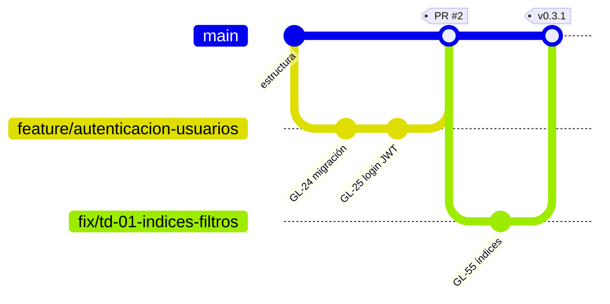

# Estrategia de ramas y trazabilidad

Se usa **GitHub Flow con ramas cortas**: `main` siempre estable y desplegable; todo el trabajo entra por Pull Request en GitHub. Cada push se copia a GitLab, donde viven los work items y el pipeline principal.



## Ramas

| Prefijo | Uso | Ejemplo |
|---|---|---|
| `main` | Rama estable. Protegida: sin push directo | — |
| `feature/*` | Funcionalidad nueva | `feature/gestion-incidentes` |
| `fix/*` | Corrección de errores o deuda técnica | `fix/td-02-limite-intentos-login` |
| `refactor/*` | Mejora interna sin cambiar comportamiento | `refactor/validaciones-centralizadas` |
| `release/*` | Preparar una versión (versión + CHANGELOG) | `release/v1.0.0` |

Reglas:

1. Una rama por tarea o por User Story cuando agrupa tareas pequeñas.
2. Nombre en minúsculas, con guiones, describiendo el cambio.
3. Ramas de vida corta (1–3 días). Se eliminan después del merge (también se eliminan en GitLab).
4. Antes de abrir el PR: `git pull origin main` y resolver conflictos en la rama.

## Commits

Formato basado en Conventional Commits, siempre con la referencia de GitLab al final:

```
<tipo>(<alcance>): <descripción en imperativo> GL-<n>
```

Tipos: `feat`, `fix`, `refactor`, `test`, `docs`, `ci`, `chore`.

```
feat(api): agregar endpoint de asignación de técnico GL-31
fix(ci): mapear JWT_SECRET_TEST en el job de pruebas GL-64
docs(seguridad): documentar manejo de secretos GL-52
```

`GL-<n>` es una referencia nativa de GitLab al work item `<n>` del proyecto. Cuando el commit llega a GitLab, el work item muestra *"mentioned in commit …"* con enlace al commit y a su pipeline. En GitHub la referencia es texto y no se confunde con los números de PR de GitHub.

## Pull Requests (GitHub)

- Plantilla obligatoria: `.github/pull_request_template.md`.
- La descripción incluye una línea `Closes <URL>` por cada work item de GitLab que el PR completa.
- En el repositorio, *Settings → General → Pull Requests → Allow merge commits* usa **Default message: Pull request title and description**. Así el merge commit lleva esas líneas `Closes <URL>`; al llegar a `main` en GitLab, GitLab cierra los work items.
- **Al menos 1 aprobación** de otro integrante; el autor no aprueba su propio PR.
- **Checks requeridos** antes del merge:
  - `Pipeline de GitLab` (pipeline principal en el runner autohospedado)
  - `Backend · lint y pruebas`, `Frontend · lint, pruebas y build`, `Revisión de dependencias` (GitHub Actions)
- Conversaciones resueltas antes del merge.
- Merge con **merge commit** (conserva los commits con `GL-<n>` en el historial de `main`).

## Protección de `main`

**GitHub** (Settings → Rules → Rulesets → `proteccion-main`):

| Regla | Valor |
|---|---|
| Restrict deletions | ✅ |
| Block force pushes | ✅ |
| Require a pull request before merging | ✅, 1 aprobación, descartar aprobaciones al hacer nuevos push |
| Require status checks to pass | ✅ checks listados arriba, rama actualizada |
| Require conversation resolution | ✅ |

**GitLab** (Settings → Repository): `main` protegida (push: Maintainers, sin force push) y tags `v*` protegidos (creación: Maintainers). Solo el espejo de GitHub empuja a GitLab, con el token del Integrante 3.

## Versiones y tags

- `main` recibe un tag anotado por versión en GitHub: `git tag -a v0.3.0 -m "v0.3.0"` y `git push origin v0.3.0`.
- El espejo lo copia a GitLab y el pipeline del tag despliega (ver [estrategia-release.md](estrategia-release.md)).
- Las versiones siguen [SemVer](https://semver.org/lang/es/) y se registran en `CHANGELOG.md`.

## Flujo completo

```
Tarea (GitLab) → feature/* (GitHub) → commits "GL-<n>" → PR → revisión + checks → merge en main
   → espejo a GitLab → pipeline → paquete (artefacto) → Staging → tag vX.Y.Z → aprobación → Producción → Release
```
