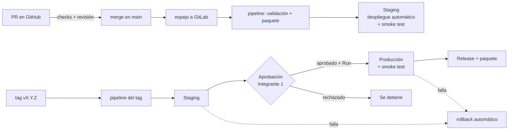

# Estrategia de release

## Resumen

**Entrega continua con promoción por ambientes**: todo cambio integrado en `main` se despliega automáticamente a **staging**; a **producción** solo llegan versiones etiquetadas, después de pasar staging, con aprobación y ejecución manual.



## Ambientes

| Ambiente | Propósito | Se despliega con | Controles |
|---|---|---|---|
| Local | Desarrollo | `npm run dev` | Lint y pruebas antes del PR |
| Staging | Validación integrada con datos de demostración | Cada push a `main` y cada tag | Pipeline en verde + smoke test + rollback automático |
| Producción | Uso real | Solo tags `vX.Y.Z` (sin sufijo) | Todo lo anterior + tag protegido + ambiente protegido con aprobación + ejecución manual |

Las pre-versiones `vX.Y.Z-rc.N` llegan solo a staging y generan un release candidato.

## Controles de aprobación y validación

| Control | Dónde | Qué evita |
|---|---|---|
| PR con revisión y checks obligatorios | GitHub (ruleset de `main`) | Código sin revisar o con el pipeline en rojo en `main` |
| Versión coherente | Job `version` | Tag que no coincide con `package.json` |
| Auditoría de dependencias | Job `dependencias` | Vulnerabilidades altas/críticas en producción |
| Smoke test | `devops/scripts/smoke-test.ps1` tras cada despliegue | Versión que no arranca, sin base de datos, sin frontend o sin autenticación |
| Rollback automático | `after_script` → `revertir-ci.ps1` → `rollback.ps1` | Que un despliegue fallido deje el ambiente caído |
| Tags protegidos `v*` | GitLab → Settings → Repository → Protected tags | Que alguien sin rol Maintainer cree versiones |
| Ambiente protegido con aprobación | GitLab → Settings → CI/CD → Protected environments → `production` (aprobador: Integrante 1) | Paso a producción sin validación humana en staging |
| Ejecución manual | `when: manual` en `deploy-produccion` | Despliegue automático a producción aun con la aprobación dada |

El aprobador revisa en staging: login con los tres roles, flujo completo de un incidente, dashboard y la versión mostrada en la barra lateral. Aprueba en *Operate → Environments → production → (deployment bloqueado) → Approve*; después, quien tiene permiso de desplegar hace clic en **Run** en el job `deploy-produccion`.

Sin la prueba de GitLab Ultimate, la aprobación del ambiente no está disponible; el control queda en el job manual dentro de un tag protegido (solo Maintainers pueden crearlo y ejecutarlo).

## Versionado semántico

`MAJOR.MINOR.PATCH` según [SemVer 2.0.0](https://semver.org/lang/es/):

- **MAJOR**: cambio incompatible en la API o en los datos.
- **MINOR**: funcionalidad nueva compatible.
- **PATCH**: corrección compatible (incluye deuda técnica y seguridad).
- **Pre-release** `-rc.N`: candidato a versión, solo staging.
- Mientras la versión es `0.y.z` el producto está en desarrollo inicial; `1.0.0` marca la primera versión estable para producción.

La versión vive en `backend/package.json` y `frontend/package.json` (deben coincidir), se muestra en la interfaz y en `/api/health`, y se registra en `CHANGELOG.md`.

### Secuencia del proyecto

| Versión | Fecha | Contenido | Ambientes |
|---|---|---|---|
| v0.1.0 | 18 oct | Estructura, espejo GitLab, autenticación, usuarios, API de incidentes | — |
| v0.2.0 | 19 oct | Frontend React | — |
| v0.3.0 | 20 oct | Dashboard, pruebas automatizadas, pipeline principal con runner propio | — (paquete) |
| v0.3.1 | 21 oct | TD-01: índices de filtros | — (paquete) |
| v0.3.2 | 21 oct | TD-02: límite de intentos de login | — (paquete) |
| v0.4.0 | 22 oct | Workflow complementario de GitHub Actions, seguridad y dependencias | — (paquete) |
| v0.5.0 | 23 oct | Despliegues, smoke test, rollback y release | Staging (producción rechazada) |
| v1.0.0-rc.1 | 24 oct | Candidato a release | Staging |
| v1.0.0 | 25 oct | Primera versión estable (PR 13 fusionado el 24 a las 23:59; tag, aprobación y producción el 25 a las 00:00–00:10) | Staging → Producción |

## Procedimiento de release

1. Crear rama `release/vX.Y.Z` desde `main`.
2. Subir la versión en ambos paquetes (sin crear tag todavía):

   ```bash
   cd backend  && npm version X.Y.Z --no-git-tag-version && cd ..
   cd frontend && npm version X.Y.Z --no-git-tag-version && cd ..
   ```

3. Mover las entradas de *Sin publicar* a `## [X.Y.Z] - AAAA-MM-DD` en `CHANGELOG.md`.
4. Commit `chore(release): vX.Y.Z GL-<n>`, PR, revisión y merge.
5. Etiquetar el merge en `main` y publicar el tag en GitHub:

   ```bash
   git checkout main && git pull
   git tag -a vX.Y.Z -m "IT Incident Hub vX.Y.Z"
   git push origin vX.Y.Z
   ```

6. El espejo copia el tag a GitLab; el pipeline del tag despliega a staging.
7. El Integrante 1 valida staging, aprueba el ambiente `production` y se ejecuta `deploy-produccion`.
8. El job `release` publica el paquete en el Package Registry y crea el Release con las notas de `CHANGELOG.md`.

## Rollback

- **Automático**: si el despliegue o el smoke test fallan después de activar la nueva versión, `after_script` restaura `previous` y reinicia PM2. Si el fallo ocurrió antes de activar, la versión actual nunca se detuvo.
- **Manual** (en el equipo del runner):

  ```powershell
  C:\incident-hub\scripts\rollback.ps1 -Ambiente production -Forzar
  ```

- **Por pipeline**: en *Operate → Environments → production*, botón **Rollback** (re-deploy) del despliegue anterior, que vuelve a ejecutar el job de esa versión con su artefacto.

La base de datos no se revierte: las migraciones son solo hacia adelante y compatibles con la versión anterior (agregar columnas/índices, nunca eliminar en la misma versión).

## Lista de verificación del release

- [ ] Work items del release cerrados en GitLab
- [ ] CHANGELOG actualizado y versión coincidente en ambos `package.json`
- [ ] Pipeline del tag en verde hasta staging
- [ ] Validación manual en staging con los tres roles
- [ ] Aprobación registrada en el ambiente `production`
- [ ] Smoke test de producción en verde
- [ ] Release publicado en GitLab con el paquete
