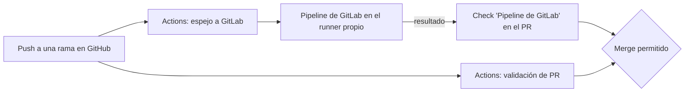
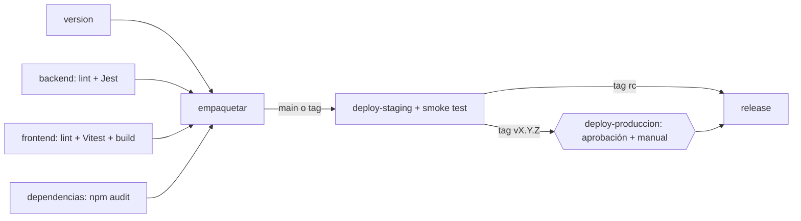

# Pipelines

Tres automatizaciones sobre el mismo repositorio:

| | GitLab CI/CD (`.gitlab-ci.yml`) | GitHub Actions: `sincronizar-gitlab.yml` | GitHub Actions: `validacion-pr.yml` |
|---|---|---|---|
| Propósito | **Pipeline principal**: validación, paquete, artefacto, despliegues y release | Copiar cada push a GitLab y reflejar el pipeline principal como check del PR | Validación complementaria y rápida de cada PR |
| Ejecuta en | Runner autohospedado (tag `incident-hub`) | `ubuntu-latest` (GitHub) | `ubuntu-latest` (GitHub) |
| Se dispara con | Cada push que llega desde el espejo: ramas, `main` y tags | Push de ramas y tags, borrado de ramas | PR a `main` y push a `main` |
| Produce | Reportes de pruebas y cobertura, reporte de dependencias, `incident-hub-X.Y.Z.zip`, despliegues, Release | Check **Pipeline de GitLab** en el PR | Checks Backend, Frontend y Revisión de dependencias |



## Pipeline principal (GitLab CI/CD)



| Job | Etapa | Ramas de trabajo | `main` | Tag rc | Tag final |
|---|---|---|---|---|---|
| `version` | validar | ✅ | ✅ | ✅ | ✅ |
| `backend` | pruebas | ✅ | ✅ | ✅ | ✅ |
| `frontend` | pruebas | ✅ | ✅ | ✅ | ✅ |
| `dependencias` | seguridad | ✅ | ✅ | ✅ | ✅ |
| `empaquetar` | empaquetar | — | ✅ | ✅ | ✅ |
| `deploy-staging` | staging | — | ✅ | ✅ | ✅ |
| `deploy-produccion` | produccion | — | — | — | ✅ manual + aprobación |
| `release` | release | — | — | ✅ | ✅ |

### Pasos obligatorios del enunciado

| Requisito | Dónde |
|---|---|
| Checkout | El runner clona el commit al iniciar cada job (*Getting source from Git repository* en el log) |
| Instalación / restauración | `npm ci` en los jobs `backend` y `frontend` |
| Build | `npm run build` (Vite) en `frontend`; el backend se valida con lint y pruebas |
| Pruebas | `npm run test:ci`: Jest con cobertura (reporte JUnit + Cobertura) y Vitest (JUnit). GitLab los muestra en la pestaña **Tests** del pipeline y el porcentaje de cobertura en el job |
| Revisión de dependencias / seguridad | Job `dependencias`: `devops/scripts/auditoria.js` sobre `npm audit`; falla con vulnerabilidades altas o críticas de producción; reporte en `reports/` |
| Empaquetado | Job `empaquetar`: `devops/scripts/empaquetar.ps1` → `incident-hub-<versión>.zip` (backend, frontend compilado en `backend/public`, migraciones, scripts de despliegue y `version.json`) |
| Publicación de artefacto | Artefacto del job `empaquetar` (30 días) y, en tags, Package Registry `incident-hub/<versión>` |

Controles adicionales:

- `version` falla si backend y frontend tienen versiones distintas o si el tag no coincide con `package.json`. Publica `APP_VERSION` para los jobs siguientes (`artifacts:reports:dotenv`).
- `resource_group` impide dos despliegues simultáneos al mismo ambiente.
- Los despliegues ejecutan `revertir-ci.ps1` en `after_script`: si el job falló, restauran la versión anterior.

## GitHub Actions

### `sincronizar-gitlab.yml`

1. **Espejo en GitLab**: `git push --force` de la rama o el tag a `https://gitlab.com/<GITLAB_PROYECTO>.git` con `GITLAB_TOKEN`. Al borrar una rama en GitHub, la borra en GitLab.
2. **Pipeline de GitLab** (solo ramas distintas de `main`): `devops/scripts/esperar-pipeline-gitlab.js` consulta la API de GitLab cada 15 s hasta que el pipeline de ese commit termina, y falla si el pipeline falla. Su resumen enlaza al pipeline. Si la rama todavía no tiene `.gitlab-ci.yml`, termina en verde sin esperar.

### `validacion-pr.yml`

Tres jobs en paralelo, requeridos como *status checks*:

1. **Backend · lint y pruebas**: `npm ci`, ESLint, Jest (secreto `JWT_SECRET_TEST`), cobertura como artefacto.
2. **Frontend · lint, pruebas y build**: oxlint, Vitest, build de Vite.
3. **Revisión de dependencias**: mismo script de auditoría (resumen en la ejecución) y `dependency-review-action`, que bloquea PRs que agregan dependencias con severidad alta.

## Fallo controlado (evidencia)

Escenario: **las pruebas del backend fallan en GitLab porque el job no recibe el secreto de pruebas**.

| | Detalle |
|---|---|
| Síntoma | Pipeline de la rama `feature/pipeline-ci` en rojo en el job `backend`: las suites que cargan la API fallan con `Falta la variable de entorno requerida: JWT_SECRET` (las pruebas unitarias puras pasan). El check **Pipeline de GitLab** del PR queda en rojo y bloquea el merge |
| Contexto | Localmente las pruebas pasan porque cada integrante tiene `backend/.env`; en el runner no existe `.env` (correcto: no se versiona) |
| Diagnóstico | En GitLab la variable se llama `JWT_SECRET_TEST`, separada del `JWT_SECRET` de staging y producción (que tiene ámbito de ambiente y no llega al job de pruebas). La aplicación lee `JWT_SECRET`, así que el job debe mapearla |
| Corrección | `variables: JWT_SECRET: $JWT_SECRET_TEST` en el job `backend` (commit `fix(ci): mapear JWT_SECRET_TEST en el job de pruebas GL-<bug>`) |
| Resultado | El siguiente pipeline pasa; el valor aparece como `[MASKED]` si se imprime; el check del PR pasa a verde |
| Aprendizaje | La configuración "falla rápido" hizo el error evidente en segundos; separar los secretos de prueba de los de los ambientes evita que una rama de trabajo reciba credenciales reales |

Enlaces de evidencia (completar):

- Pipeline fallido: `<URL del pipeline en GitLab>`
- Bug en GitLab: `GL-<n>`
- Commit de corrección: `<URL del commit>`
- Pipeline exitoso: `<URL del pipeline en GitLab>`
- PR con el check en rojo y luego en verde: `<URL del PR en GitHub>`

## Insignias para el README

```markdown
[](https://gitlab.com/<grupo>/incident-hub/-/pipelines)
[](https://gitlab.com/<grupo>/incident-hub/-/pipelines)
[](https://github.com/<usuario>/incident-hub/actions/workflows/validacion-pr.yml)
```
